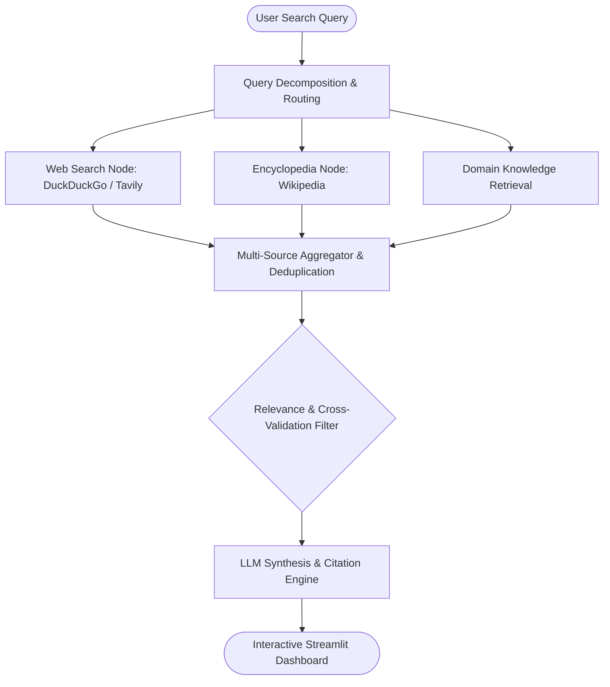

# AI Multi-Search Agent 🌐🤖

<p align="center">
  
  
  
  
  
</p>

**AI Multi-Search Agent** is a multi-source intelligent retrieval and synthesis engine designed to coordinate heterogeneous web sources (DuckDuckGo, Wikipedia, Search APIs), evaluate content relevance, and synthesize multi-perspective summaries using **LangGraph** orchestration and **LangChain**.

---

## 🏗️ Retrieval & Synthesis Architecture



---

## 🚀 Key Features

- **Multi-Source Aggregation**: Asynchronously dispatches queries across heterogeneous search endpoints, merging disparate results into a unified context window.
- **Agentic Orchestration (LangGraph)**: Multi-step reasoning pipeline evaluating information consistency and resolving cross-source contradictions.
- **Context-Aware Query Expansion**: Breaks complex exploratory questions into targeted sub-queries for broader semantic coverage.
- **Interactive UI**: Real-time Streamlit workspace with live progress indicators and citation traces.

---

## 🛠️ Project Structure

```
ai-multi-search-agent/
│
├── main.py                    # Streamlit frontend entry point & user workspace
├── snapshot_operations.py     # Custom LangGraph state nodes and workflow compiler
├── web_operations.py          # Search API connectors, parsers, and node definitions
├── prompts.py                 # Structured system prompts and synthesis templates
├── pyproject.toml             # Package metadata and environment specifications
├── requirements.txt           # Pinned production dependencies
├── .env.example               # Environment variables configuration template
└── README.md                  # Comprehensive project documentation
```

---

## 📦 Quick Start Guide

### 1. Clone Repository

```bash
git clone https://github.com/mohammed-m-alhaj/ai-multi-search-agent.git
cd ai-multi-search-agent
```

### 2. Environment Setup

```bash
# Create virtual environment
python -m venv venv

# Activate virtual environment
# Windows (PowerShell):
venv\Scripts\activate
# Linux / macOS:
source venv/bin/activate

# Install dependencies
pip install -r requirements.txt
```

### 3. API Configuration

Create a `.env` file from the template:

```bash
# Windows:
Copy-Item .env.example .env
# Linux / macOS:
cp .env.example .env
```

Set your API keys inside `.env`:
```ini
OPENAI_API_KEY=your_openai_api_key_here
```

### 4. Run Application

```bash
streamlit run main.py
```
Open your browser at `http://localhost:8501`.

---

## 💡 Example Scenario

```text
💬 Input Query:
   "Analyze the architectural trade-offs between dense vs. sparse vector indexes in RAG pipelines"

⚙️ Orchestrated Retrieval:
   ├── Query Node A: [Vector Indexing Benchmarks 2026]
   ├── Query Node B: [HNSW vs IVF vs BM25 Hybrid Search trade-offs]
   └── Query Node C: [Memory overhead & recall trade-offs]

📊 Synthesized Response:
   Comprehensive comparison table detailing recall rates, query latency, index build times, and hybrid RRF (Reciprocal Rank Fusion) best practices with full source attribution.
```

---

## 👨‍💻 Author & Attribution

Developed by **[Mohammed AL-Haj](https://github.com/mohammed-m-alhaj)**  
AI Engineer specializing in LLMs, Multi-Agent Systems, and Computer Vision.

- 📧 Email: `ai.mohammed.alhaj@gmail.com`
- 💼 LinkedIn: [mohammed-al-haj](https://linkedin.com/in/mohammed-mohammed-al-haj-341ab7369)
- 🐙 GitHub: [@mohammed-m-alhaj](https://github.com/mohammed-m-alhaj)
