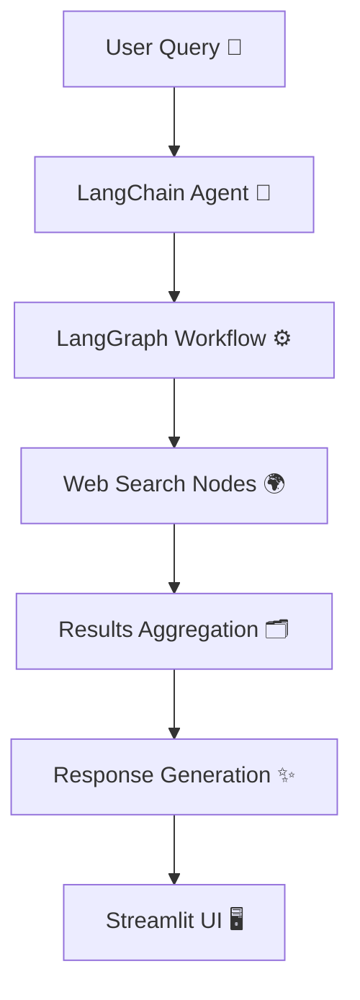

# 🌐 AI Multi Search Agent 🤖

An **advanced multi-source AI search assistant** powered by **LangChain**, **LangGraph**, and **Streamlit**.  
It intelligently searches across the web, aggregates data, and summarizes insights — all in one beautiful interface. 🚀

---

## 🧠 Project Overview

**AI Multi Search Agent** is an AI-driven web search system that connects multiple data sources using the power of **LangChain** and **LangGraph**.  
It allows users to:

- 🔍 Search multiple sources (Google, Wikipedia, etc.)
- 🧩 Build intelligent reasoning graphs
- 💬 Interact with a friendly Streamlit chat interface
- ⚙️ Use environment variables from `.env` for API keys and configuration

---

## 🏗️ Project Structure

```

ai-multi-search-agent/
│
├── .env                       # Environment variables (API keys, secrets)
├── README.md                  # Documentation (this file)
├── pyproject.toml             # Project metadata and dependencies
│
├──streamlit.py                #GUL
├── main.py                    # 🧠 Streamlit web app entry point
├── prompts.py                 # 💬 Predefined prompts and templates
├── snapshot_operations.py     # ⚙️ Defines custom AI agents and workflows
├── web_operations.py          # 🌐 Web search + LangGraph node definitions
└── assets/                    # 🖼️ Images, diagrams, or icons used in the app

```

---

## ⚙️ Technologies Used

| Library                   | Purpose                                           |
| ------------------------- | ------------------------------------------------- |
| **LangChain**             | Building LLM-based chains and pipelines           |
| **LangGraph**             | Defining multi-step AI workflows and state graphs |
| **Streamlit**             | Frontend web interface for user interaction       |
| **python-dotenv**         | Loading environment variables from `.env`         |
| **OpenAI API / Web APIs** | Data generation and search retrieval              |

---

## 🧩 How It Works (Flow Diagram)



**Explanation:**

1. The user sends a query through the Streamlit interface.
2. LangChain processes and forwards it into the LangGraph workflow.
3. The graph orchestrates calls to different web search nodes.
4. Results are aggregated, analyzed, and summarized using AI.
5. The final response is displayed beautifully in the Streamlit UI.

---

## 🧪 Quick Start Guide

### 1️⃣ Clone the Repository

```bash
git clone https://github.com/mohammed-alhaj-7ds/ai-multi-search-agent.git
cd ai-multi-search-agent
```

### 2️⃣ Create `.env` File

```bash
touch .env
```

Add your API keys inside:

```bash
OPENAI_API_KEY=your_openai_key_here
```

### 3️⃣ Install Dependencies

```bash
pip install -r requirements.txt
```

or if using **pyproject.toml**:

```bash
pip install .
```

### 4️⃣ Run the Streamlit App

```bash
streamlit run main.py
```

---

## 💡 Example Usage

When you run the app:

1. Enter a query (e.g., _“Compare AI models GPT-4 vs Claude 3”_)
2. The system runs a multi-source search across the web
3. LangGraph orchestrates agents to summarize and merge results
4. The response appears in an elegant Streamlit UI

---

## 🧰 Example Streamlit Code (main.py)

```python
import streamlit as st
from snapshot_operations import run_agent

st.set_page_config(page_title="AI Multi Search Agent", page_icon="🤖")

st.title("🌐 AI Multi Search Agent")
query = st.text_input("🔍 Enter your search query:")

if st.button("Search"):
    with st.spinner("Processing your query..."):
        result = run_agent(query)
        st.write("### 🧠 AI Summary")
        st.write(result)
```

---

## 🧩 Future Improvements

- 🔗 Add more data sources (YouTube, Arxiv, Twitter)
- 🧠 Integrate local document search (RAG)
- 🎨 Enhance UI/UX with Streamlit components
- 🗃️ Store past searches in SQLite

---

## 👨‍💻 Author

**Mohammed Alhaj**
📧 `malborwa@gmail.com`
🔗 GitHub: [mohammed-alhaj-7ds](https://github.com/mohammed-alhaj-7ds)

---

⭐ _If you like this project, give it a star on GitHub!_
